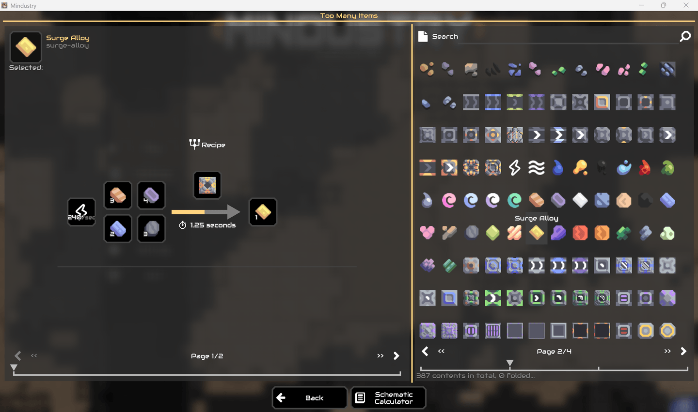
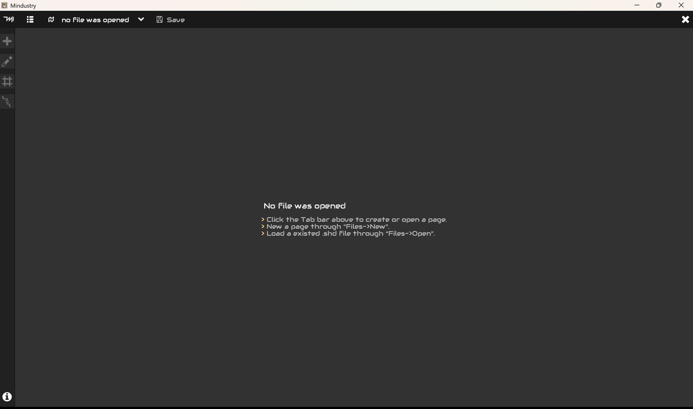
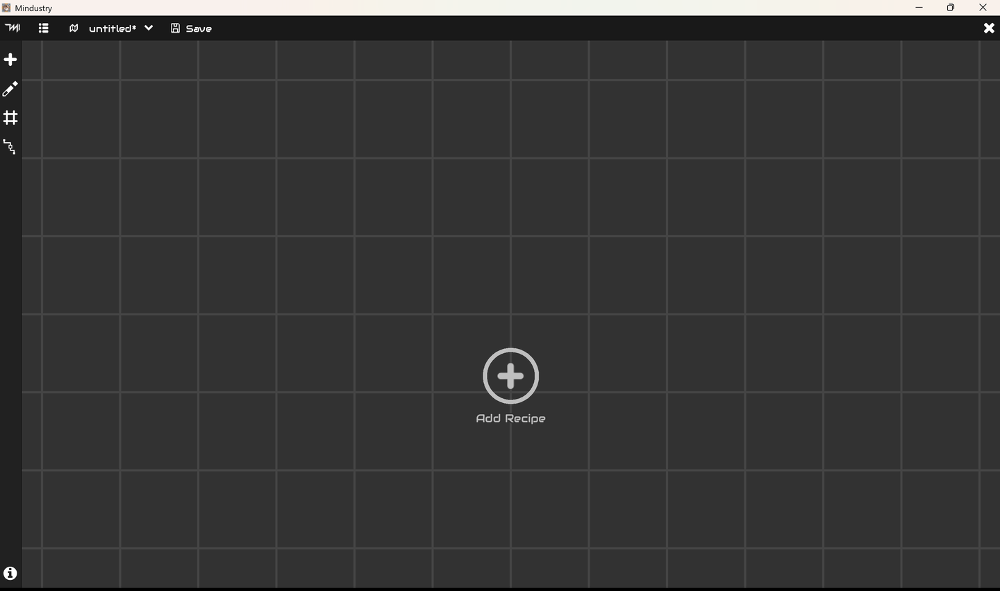
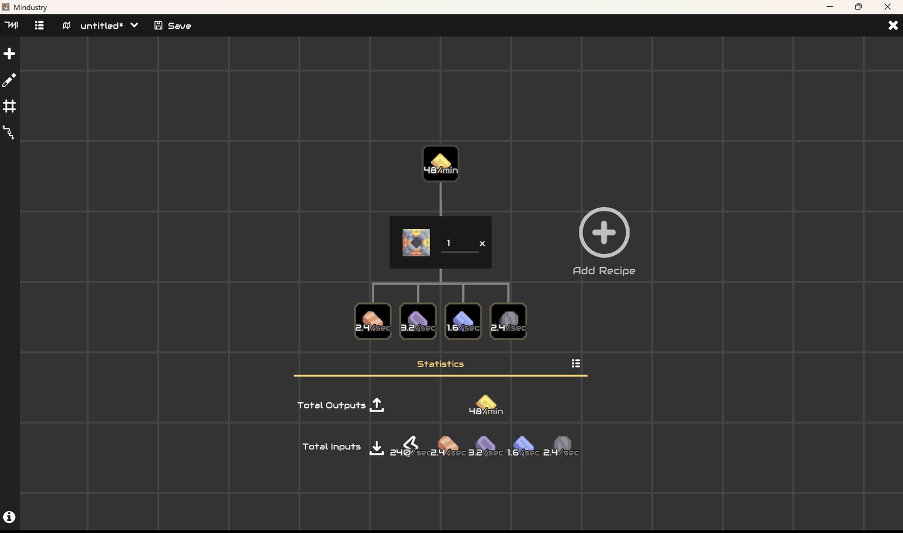
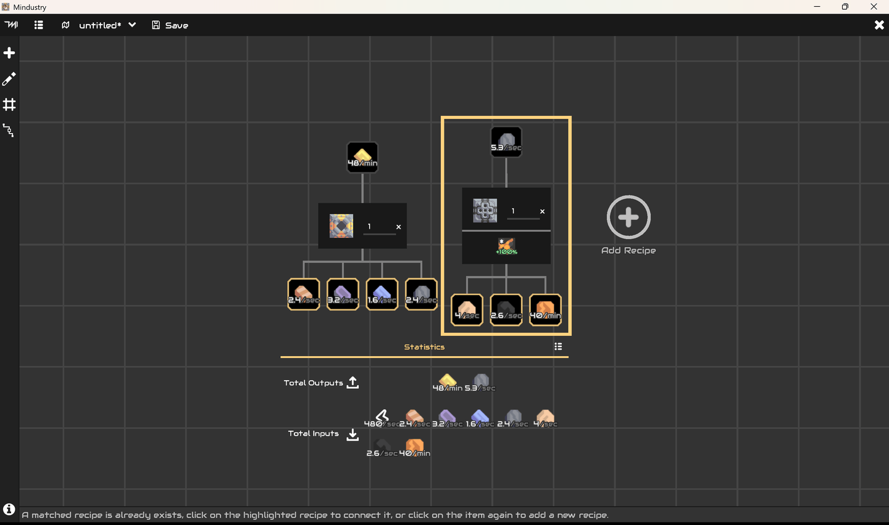
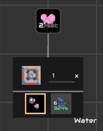
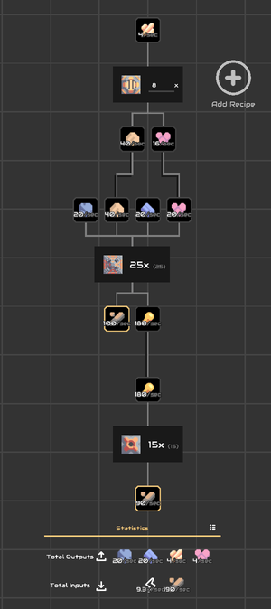
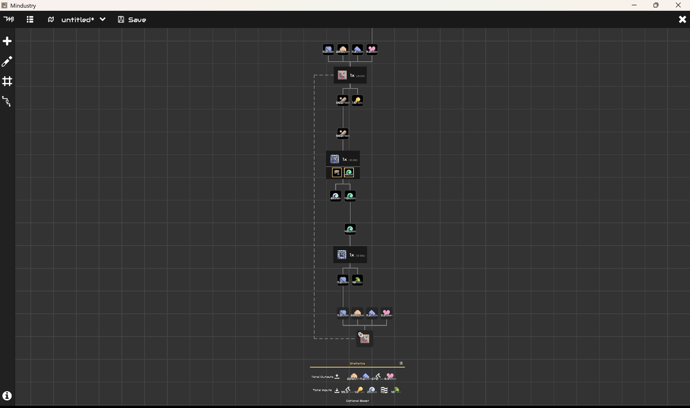
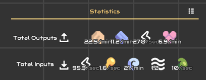

## Schematic Calculator User Instructions

The Schematic Calculator is a tool used to quickly calculate the balanced quantities of various factories when constructing a production line containing multiple factories. This document aims to concisely explain the usage methods and operational details of the Schematic Calculator.

You can find the entry point to the Schematic Calculator at the bottom of the *TooManyItems* recipe browser interface:

### Getting Start

When you open the Schematic Calculator, you will see the following interface. By default, it is in a state with no tabs open:

It can be roughly divided into:

- **Top Tab Bar**: Contains the menu and quick action buttons related to the page or file currently being edited.
- **Left Toolbar**: A series of tools frequently used during editing, such as adding recipes and toggling grids.
- **Central Workspace**: The editing area, where most operations are performed.

You can quickly select previously opened `.shd` files via the page tabs on the top toolbar, or create a new schematic. If you create a new blank schematic, you will see the following interface:

This view can be freely dragged and zoomed on mobile devices, while on desktop environments, you can drag the view with the left mouse button and zoom using the scroll wheel.

> Operation prompts are displayed at the bottom of the workspace. When you hover your touch or mouse over certain controls, the prompt bar will display help information about that control.

---

#### Editing the Recipe Tree

Click 'Add Recipe' in the center to open the recipe selector. You can add a recipe to the view by clicking the '+' sign displayed below the recipe you want to add. The added recipe will be simplified into a recipe card showing its materials, products, and their quantities:

For the input materials on a recipe card, if there is no recipe in the view that produces that item, clicking on them will open the recipe selector. The selector will display all filtered recipes that produce that item, with a button displayed below them. Clicking this button will add the recipe to the view and connect it to the card.

If a recipe that produces the item already exists in the view, the cards that can produce this item will be highlighted with a border. You can connect that recipe to the recipe card by clicking on those highlighted recipes. Highlighted cards:

If you do not want to connect to an existing card, you can click the selected item again to normally add a new recipe and connect it.

For output products, you can right-click (or double-tap quickly on mobile devices) to open the recipe selector, choose the recipe it participates in, and add it to the view. However, unlike for inputs, you cannot select an existing card and connect it for products. Additionally, the added recipe will not be linked to the card unless auto-connect is enabled.

> By default, the auto-connect function is enabled. When you add a new recipe, aside from the selected entry being linked to the target card, all other material and product entries will automatically search for matching recipe cards in the view and attempt to connect to them. You can toggle the auto-connect mode via the 'Auto-Connect Mode' switch on the left toolbar.

Right-clicking (or double-tapping quickly on mobile devices) the block icon on a recipe card will disconnect all connections on that recipe and delete the recipe.

---

#### Recipe Card Configuration

Some factories can improve their work efficiency through environmental items or optional inputs. These related settings are displayed on the recipe card, using a drill as an example:

Its environmental items and optional inputs are displayed in the center. For recipes with selectable environmental items, clicking the environmental item allows you to choose a different one. Clicking an optional input item toggles its enabled state; the recipe only includes the optional item in its materials when it is enabled.

These configurations directly affect the work efficiency of the recipe and influence the balanced ratio calculation for this recipe.

> Once an optional item is enabled, its efficiency increase takes effect immediately, regardless of whether it is connected to a recipe that produces that material.

---

#### Calculating Ratios

You can build a recipe tree following the above operations. All recipes with no output target cards connected are placed in the top row. Only the cards in the top row can have quantities set, which are treated as target quantities for calculating the balanced ratios of subsequent recipes:

Whenever you set a target quantity for any top-row recipe or change the structure of the recipe tree, the Schematic Calculator will automatically calculate the required quantities for each recipe and display them as numbers in the center of each card.

Next to this number, there is a dimmed decimal. This number represents the floating-point ratio multiplier required for this recipe. It may indicate that some factories need non-integer ratio amounts, meaning some factories may not run at full efficiency. Rounding up gives the number of factories needed for actual production line construction.

Strictly speaking, what the Schematic Calculator can build is not just a 'recipe tree' but a 'recipe graph.' It allows you to connect the output product of one recipe to several different cards, forming a large and complex product transfer route. Typically, the Schematic Calculator can correctly compute these.

There are special cases. When you connect the output of a production line back to its input, this forms a looped production structure. The starting node of the loop will generate a shadow node in the view to transfer the product back to the production line's input:

This situation is relatively rare, but in most cases, the Schematic Calculator can still correctly calculate the balance. However, if the production and consumption ratios within this loop structure cannot sustain the cycle itself while also outputting sufficient products externally, the loop becomes a divergent loop. A divergent loop in the production line will only consume the target product without producing it. When a divergent loop exists in the view, the Schematic Calculator will be unable to calculate it correctly, meaning the factory designed with this structure will not function properly.

---

#### Statistics Information

For any recipe tree, after completing the ratio balance calculation, the calculator will compute the total consumption and production sums and display them summarized below the recipe tree:

Clicking the button on the right allows you to view detailed statistics information for the recipes, including specific production and consumption, redundancy, building consumption, etc.