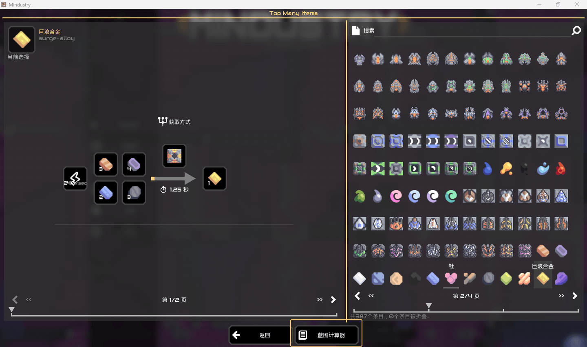
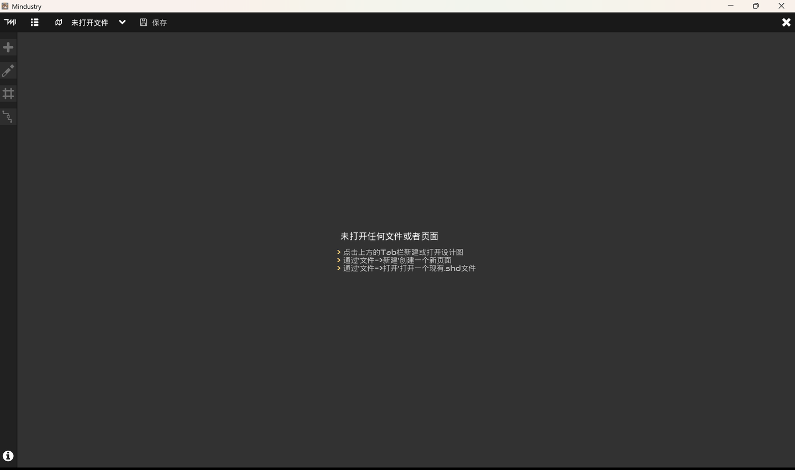
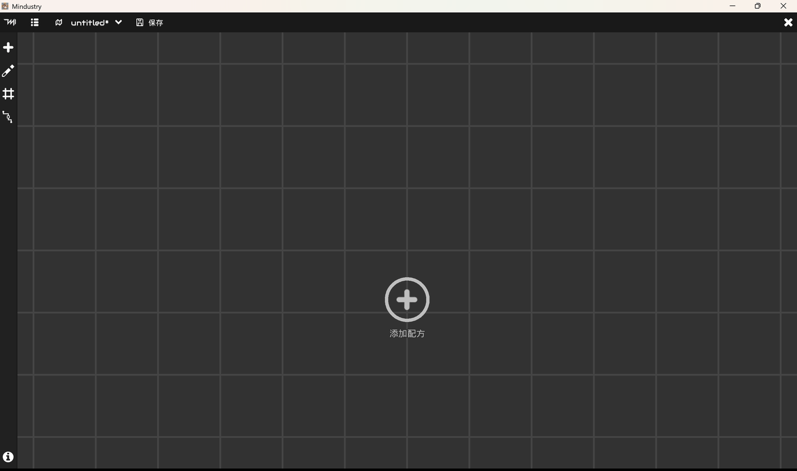
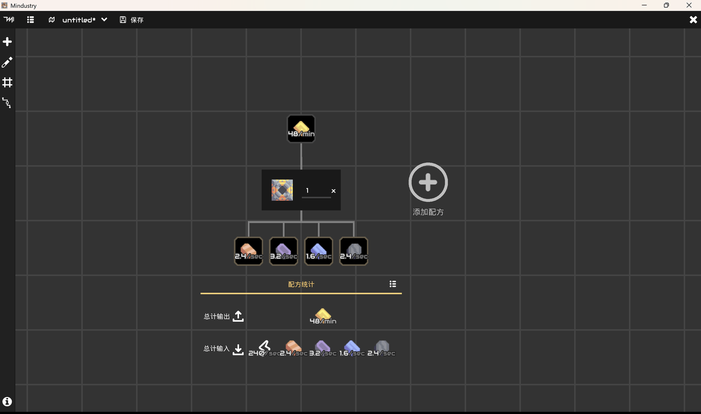
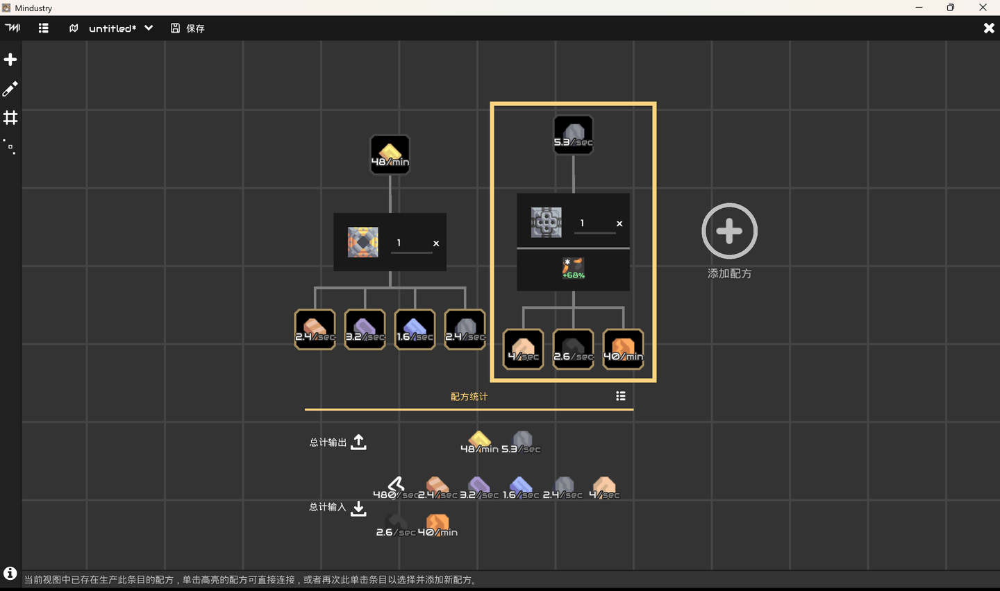
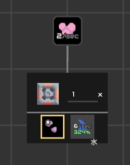
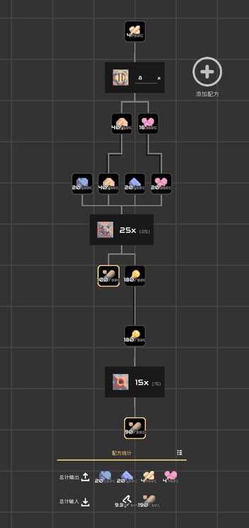
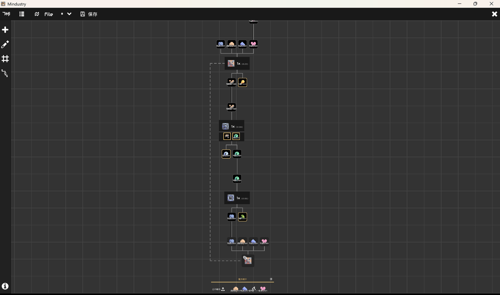
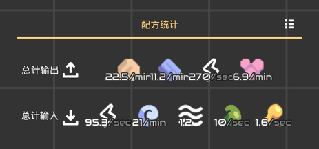

## 蓝图计算器使用说明

蓝图计算器是在建造含有若干个工厂的产线时，用于快速计算各工厂的平衡数量的工具。此文档旨在简明扼要的说明蓝图计算器的使用方法与操作细节。

您可以在*TooManyItems*的配方浏览器界面下方找到蓝图计算器的入口：

### 快速开始

在您打开蓝图计算器时会看到如下界面，默认状况下处于未打开任何标签页的状态：

其中，大致可分为：

- **顶部标签栏**：包含菜单和关于正在编辑的页面或文件的快速操作按钮。
- **左侧工具栏**：在进行编辑时会经常使用的一系列工具，如添加配方和开关网格等。
- **中央操作区**：编辑区，大部分操作都在此进行。

您可以通过顶部工具栏的页面标签快速选择之前打开过的`.shd`文件，或者新建一个设计图，如果您新建了一个空白的设计图，你将会看到如下界面：

该视图在移动设备上可以任意拖动和缩放，而在桌面环境下则可用鼠标左键拖动视图，使用滚轮进行缩放。

> 操作区下方会显示操作提示，在您的触控或鼠标悬停在某些控件上时，提示栏会显示关于该控件的帮助信息。

---

#### 编辑配方树

点击中央的'添加配方'可打开配方选择器，您可以通过点击要添加的配方下方显示的'+'号将那个配方添加到视图当中，添加的配方将会按材料、产物以及其数量简化为一个配方卡片：

对于配方卡片的输入材料，如果在视图中没有产出该项目的配方，在您单击它们时可以打开配方选择器，选择器中会显示经过过滤的所有产出该项目的配方，其下方会显示一个按钮，点击按钮可将此配方添加到试图并将此项与该卡片进行连接。

如果视图当中已经存在产出该项目的配方时，则会先高亮框出那些可以生产此项目的配方，您可以通过单击那些高亮的配方来将那个配方连接到该配方卡片。高亮显示的卡片：

如果您并不想连接到现有的卡片，那么可以再次点击选中的项目以正常的添加新配方并连接它。

而对于输出产物，您可以通过鼠标右击（在移动设备上为快速双击）打开配方选择器选择其参与的配方，并将其添加到视图，但不同的是对于产物，您不能选择已存在的卡片并连接，同时添加的配方不会在未开启自动连接的情况下链接到该卡片。

> 在默认情况下自动连接功能是启用的，在您添加一个新的配方时，除被选中的那个条目会链接到目标卡片外，其余的各个材料项和产物项会在视图中自动搜索匹配的其他配方卡片，并尝试连接到它们。您可以通过左侧工具栏的'自动连接模式'开关自动链接模式。

而通过右击（或在移动设备上快速双击）配方卡片中的方块图标则可以断开此配方上的所有连接并删除此配方。

---

#### 配方卡片配置

一些工厂可以通过环境项或输入一些可选项来提高其工作效率，而这些相关的设置都会显示在配方卡片中，以钻头为例：

它的环境项和可选输入会显示中央，对于有其他可以选择的环境项的配方，可单击环境项来选择不同的环境项；而单击可选输入项可切换其启用状态，同时配方仅在启用可选项时才会将可选项显示在材料当中。

这些配置均会直接影响该配方的工作效率，并影响此配方的平衡配比计算。

> 可选项启用后其效率增幅直接生效，与是否连接到产出该材料的配方无关。

---

#### 计算配比

您可以按照上述的操作构建一个配方树，而所有没有连接输出目标卡片的配方会被放置在首行上，同时也只有首行的卡片可以设置数量，该数量会被视为目标数量用于计算其后续各个配方的配比平衡数量：

在您设置任意一个首行配方的目标数量，或改变配方树的结构时，蓝图计算器都会自动计算各个配方需要的数量，并将它显示在各个卡片中央的数字上。

这个数字旁还有一个弱化的小数，该数字表示的是此配方需求的配比浮点倍数，因为在生产配比平衡时有的配方需要非整数的配比量，这可能意味着部分工厂不会以满效率运行，而它向上取整就是配方在实际产线建造时的工厂数量。

严格的说蓝图计算器可以构建的并不仅是一个'配方树'，而是一个'配方图'，它允许您将一个配方的输出产物连接到若干个不同的卡片上，构成一个庞大而复杂的产物传递路线，通常蓝图计算器可以正确的计算它们。

也有特殊情况，当您将生产线的输出接回到产线的输入端时，这会形成一个环形的生产结构，而环的起始节点会在视图中生成一个影子节点将产物传递回到产线的输入端：

这种情况是相对少见的，但是在大部分情况下蓝图计算器依然能正确的计算它们的平衡，但是如果在这个环形结构中的生产与消耗比例无法满足环本身的循环并有充足的产品向外输出时，该环就是一个发散环，而发散环在产线中只会消耗目标产物，而无法生产它，当视图中存在发散环时，蓝图计算器将无法正确计算它们，这也意味着您按照这个结构设计的工厂将无法正常工作。

---

#### 统计信息

对于任意一个配方树，在完成配比平衡计算后，计算器会计算出它们消耗与产出的总和，并将它们汇总显示在配方树下方：

点击右侧的按钮可以查看配方的详细统计信息，包括具体的产出和消耗，冗余量以及建筑消耗等。
